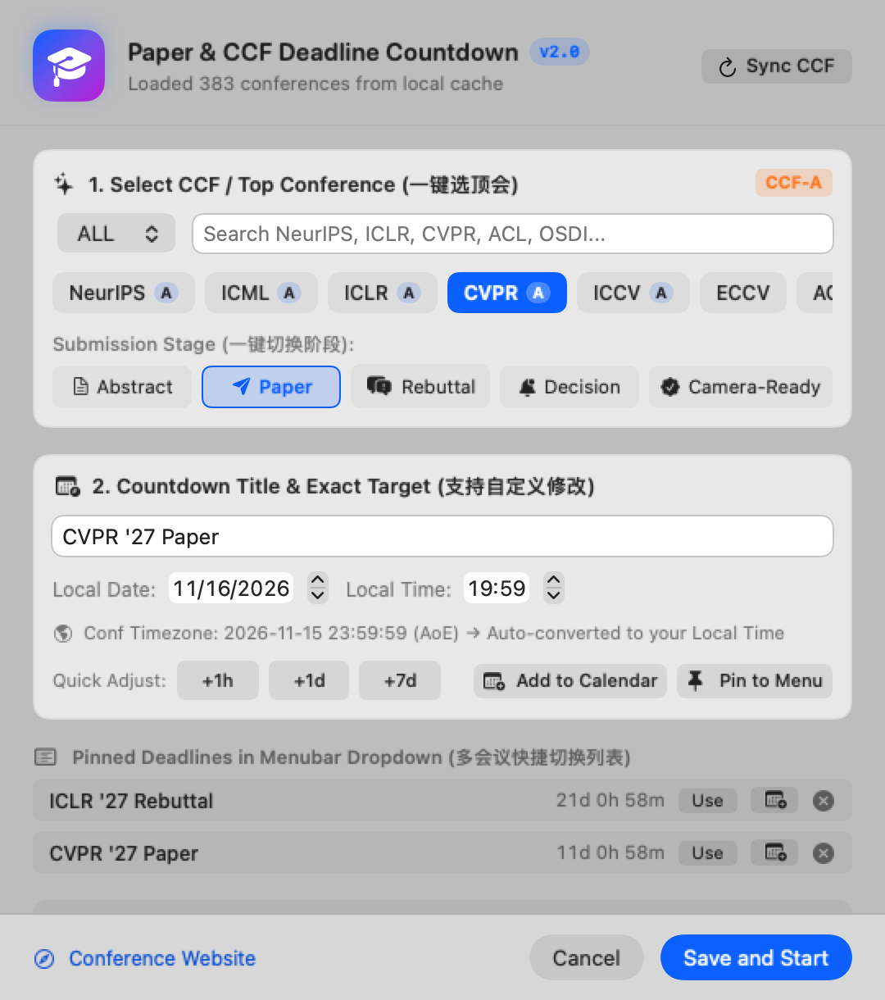

# Paper & CCF Statusbar Countdown for macOS / macOS 学术顶会与投稿菜单栏倒计时

**English** | **[简体中文](#简体中文)**

A native macOS menu bar countdown utility tailored for academic paper submissions and CCF conference deadlines (NeurIPS, ICLR, ICML, CVPR, ACL, AAAI, KDD, OSDI, CHI, etc.), written in pure Swift & SwiftUI.

Based on [bbrks/osx-statusbar-countdown](https://github.com/bbrks/osx-statusbar-countdown) and enhanced with native [ccfddl](https://github.com/ccfddl/ccf-deadlines) / [CCFBar](https://github.com/superpung/CCFBar) cloud synchronization — **no Python, no SwiftBar, and no manual JSON/YAML configuration required**.

<p align="center">
  
</p>

---

## ✨ Key Features (v2.0)

- 🎓 **One-Click CCF & Top Conference Presets**: Built-in and cloud-synced deadlines from `ccfddl.com` across all 10 CCF categories (`AI`, `SE`, `DB`, `NW`, `SC`, `DS`, `CG`, `HI`, `CT`, `MX`).
- 🔄 **One-Click Paper Submission Stages**: Instantly switch between **Abstract**, **Paper**, **Rebuttal**, **Decision**, and **Camera-Ready** countdowns.
- 🌎 **Automatic AoE & Timezone Conversion**: Automatically converts conference deadlines (`AoE / UTC-12`, `UTC+0`, etc.) into your local timezone, while displaying both local and origin deadlines in the menu bar dropdown.
- 📌 **Multi-Deadline Pinning & Quick Switch (`⌘1`–`⌘9`)**: Pin multiple upcoming paper deadlines to the dropdown menu and switch the active menu bar display with a single click.
- 📅 **One-Click Calendar Import (`⌘E`)**: Export any conference or paper stage deadline directly to Apple Calendar (or Outlook/Fantastical) with automatic **7-day, 1-day, and 1-hour advance reminders** (`VALARM`), conference URL, and origin timezone notes.
- 💎 **Modern macOS Vibrancy & Monospaced Typography**: Redesigned with native SwiftUI, `NSVisualEffectView` popover blur, SF Symbols icons, and jitter-free monospaced digits (`monospacedDigitSystemFont`).

## 🚀 Installation & Usage

### Option 1: Download Pre-built `.app` (Recommended)
1. Download `StatusbarCountdown-macOS.zip` from **[Releases](../../releases)**.
2. Unzip and move `StatusbarCountdown.app` to `/Applications` (or double-click to launch directly).
3. Click the timer in the top-right macOS menu bar → **Paper & CCF Preferences… (`⌘,`)** to select a conference or customize your countdown.

> If macOS Gatekeeper prompts about an unidentified developer, run `xattr -cr StatusbarCountdown.app` or **Control-Click → Open**.

### Option 2: Build from Source
No full Xcode installation is required (works out-of-the-box with macOS Command Line Tools):
```bash
git clone https://github.com/GaAs9000/macos-paper-countdown.git
cd macos-paper-countdown
./build.sh
open StatusbarCountdown.app
```

---

<a name="简体中文"></a>
## 🇨🇳 简体中文说明

专为学术论文投稿与 CCF 顶会截稿设计的 **macOS 原生菜单栏倒计时工具**（支持 NeurIPS、ICLR、ICML、CVPR、ACL、AAAI、KDD、OSDI、CHI 等全领域顶会），基于纯正 Swift + SwiftUI 构建。

本项目在 [bbrks/osx-statusbar-countdown](https://github.com/bbrks/osx-statusbar-countdown) 的基础上进行了全方位视觉重构，并原生集成了 [ccfddl](https://github.com/ccfddl/ccf-deadlines) 与 [CCFBar](https://github.com/superpung/CCFBar) 的云端会议数据库——**无需安装 SwiftBar、无需配置 Python 环境、无需手写 JSON/YAML 配置文件，双击即用，秒级丝滑跳动**。

### ✨ 核心亮点

1. 🎓 **一键选择 CCF / 顶会截稿时间**：内置常用顶会离线种子库，并支持一键从 `ccfddl.com` 云端同步全部 10 大领域（`AI`、`SE`、`DB`、`NW`、`SC`、`DS`、`CG`、`HI`、`CT`、`MX`）最新截稿数据。
2. 🔄 **投稿全阶段一键切换**：支持 **Abstract（摘要）**、**Paper（全文）**、**Rebuttal（反驳）**、**Decision（录用通知）**、**Camera-Ready（终稿）** 五大阶段一键切换与自定义微调。
3. 🌎 **自动 AoE / 会议时区换算**：自动将顶会常用的 `AoE (UTC-12)` 或 `UTC+0` 精确换算为您当前的系统本地时间（如北京时间 `GMT+8`），并在菜单栏下拉列表中同时展示本地时间与会议原始时区时间。
4. 📌 **多会议收藏与菜单栏秒切（`⌘1`–`⌘9`）**：同时投递多篇论文时，可将多个会议阶段固定（Pin）到下拉菜单列表，点击任意一项即可瞬间切换菜单栏主倒计时。
5. 📅 **一键导入系统日历提醒（`⌘E`）**：支持在下拉菜单或设置窗口一键将截稿时间导入 macOS「日历」（Apple Calendar / Outlook / Fantastical），自动附带 **提前 7 天、提前 1 天、提前 1 小时** 三重提醒闹钟，以及会议官网和原始时区备注。
6. 💎 **原生 macOS 毛玻璃与等宽数字排版**：采用 `NSVisualEffectView` 原生毛玻璃设置面板、SF Symbols 矢量图标与系统级等宽数字字体（每秒跳动绝不晃动菜单栏宽度）。

### 📦 安装与使用

#### 方式一：直接下载编译好的应用包（推荐）
1. 前往 **[Releases](../../releases)** 页面下载最新的 `StatusbarCountdown-macOS.zip`。
2. 解压后双击 `StatusbarCountdown.app` 即可在屏幕右上角菜单栏看到倒计时（也可拖入「应用程序 `/Applications`」文件夹，或在「系统设置 → 通用 → 登录项」中设为开机自启）。
3. 点击顶部菜单栏倒计时 → 选择 **`Paper & CCF Preferences… (⌘,)`** 即可搜索顶会、切换阶段或自定义倒计时。

#### 方式二：源码一键编译
只需安装 macOS Command Line Tools 即可通过内置脚本一键构建并签名 `.app`：
```bash
git clone https://github.com/GaAs9000/macos-paper-countdown.git
cd macos-paper-countdown
./build.sh
open StatusbarCountdown.app
```

---

## 📄 Credits & License
- Original StatusbarCountdown by [Ben Brooks](https://github.com/bbrks/osx-statusbar-countdown)
- Conference deadline data powered by [ccfddl/ccf-deadlines](https://github.com/ccfddl/ccf-deadlines) & inspired by [superpung/CCFBar](https://github.com/superpung/CCFBar)
- Licensed under the [MIT License](LICENSE).
